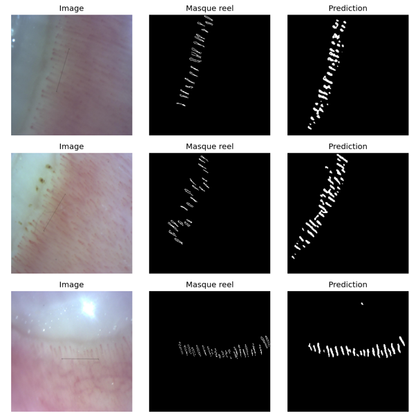
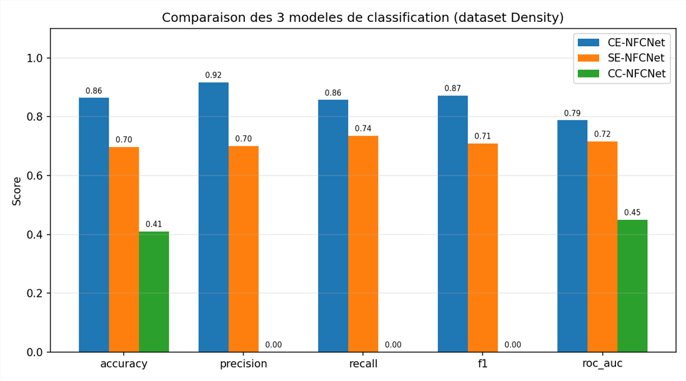
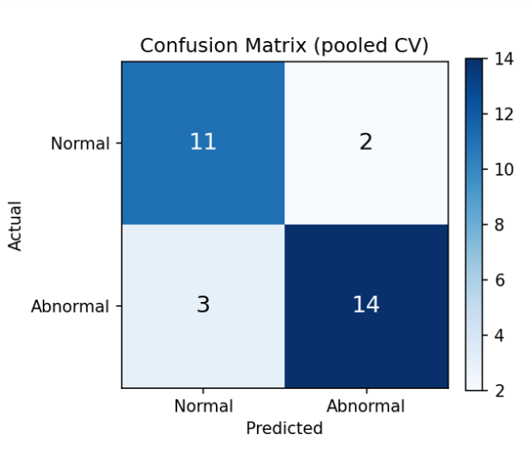
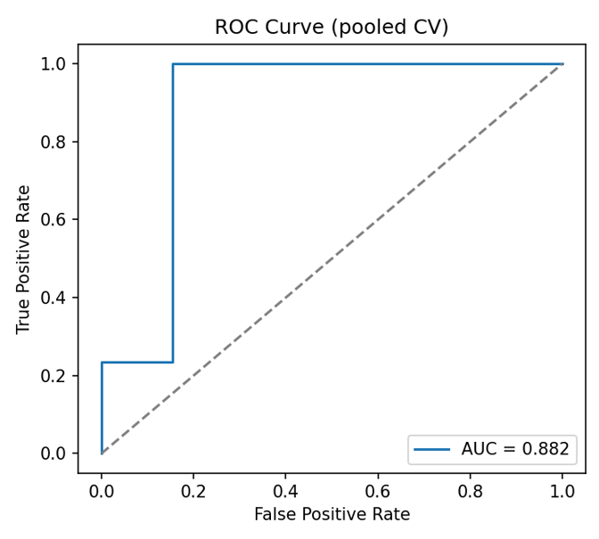

<div align="center">

# Nailfold Capillaroscopy: Abnormality Classification and Capillary Segmentation

**Reproduction of CE-NFCNet (EfficientNet-B0 with cascade transfer learning) for Normal vs Abnormal classification, plus a U-Net for capillary segmentation, in PyTorch**

[](https://www.python.org/)
[](https://pytorch.org/)
[](https://scikit-learn.org/)



<sub>U-Net capillary segmentation on validation images. Left: input image, middle: ground-truth mask, right: prediction.</sub>

</div>

---

## Overview

Nailfold capillaroscopy (NFC) is a non-invasive imaging technique that shows the small blood vessels at the base of the fingernail. Changes in their shape and density are early markers of diseases such as systemic sclerosis. Reading these images is done by hand today, which is slow and varies between experts.

This Master's project (VIBOT, Computer Vision, 2026) reproduces and critically analyses the method of
**Ebadi Jalal et al., "Abnormality detection in nailfold capillary images using deep learning with EfficientNet and cascade transfer learning", *Scientific Reports* 15:2068 (2025)**, and adds a segmentation stage:

- **Part A, classification:** implement and compare the paper's three models on a Normal vs Abnormal task.
- **Part B, segmentation:** train a U-Net to segment capillaries pixel by pixel.

## Highlights

- **Three classifiers compared**, differing in the depth of transfer learning:
  - **CE-NFCNet**: EfficientNet-B0 (ImageNet) with blocks 6, 7 and 8 fine-tuned, plus the paper's regularisation head (Dropout, GAP, Dropout, BatchNorm, Dense).
  - **SE-NFCNet**: same backbone, only block 8 fine-tuned.
  - **CC-NFCNet**: small CNN trained from scratch.
- **Leakage-free evaluation**: subject-grouped stratified cross-validation (`StratifiedGroupKFold`), so no person's images are in both training and validation.
- **Small, imbalanced data handled explicitly**: inverse-frequency class weights, the paper's augmentations (rotation up to 72°, flips, brightness/contrast), early stopping.
- **U-Net segmentation** with a **BCE + Dice** loss to deal with capillaries covering only about 1% of the pixels.

## Results

### Part A: classification (30 images, 4 subjects, mean over subject-grouped folds)

| Model | Accuracy | Precision | Recall | F1 | ROC-AUC |
|---|---|---|---|---|---|
| **CE-NFCNet** (cascade EfficientNet) | **0.864** | **0.917** | **0.857** | **0.871** | **0.788** |
| SE-NFCNet (single EfficientNet) | 0.697 | 0.700 | 0.736 | 0.709 | 0.717 |
| CC-NFCNet (CNN from scratch) | 0.410 | 0.000 | 0.000 | 0.000 | 0.450 |

<p align="center"></p>

Leave-subject-out prediction on every image (each subject scored by the model that never saw it): **25/30 correct (0.833)**, pooled ROC-AUC 0.882.

<p align="center">
  
  
</p>

The paper's ranking **CE > SE > CC** is reproduced: the deeper the transfer learning, the better the result on a tiny dataset. The model trained from scratch collapses to a single class.

### Part B: segmentation (70 image/mask pairs, 56 train / 14 validation)

| Model | Input | Epochs | Best validation Dice | IoU |
|---|---|---|---|---|
| U-Net (32 base channels, CPU training) | 256×256 | 120 | **0.354** | ~0.20 |

The training loss fell steadily from 1.57 to 0.68 and had not yet levelled off. The gap to the 0.83 Dice reported by Chen et al. (613 images, pre-trained attention U-Net, GPU) comes mainly from the amount of data and compute.

### Limitations and next steps

- With only 4 subjects, fold metrics have a high variance, and CE-NFCNet's probabilities often sit close to 0.5. More subjects are needed before these scores can be trusted.
- Next steps: a pre-trained encoder (ResNet or EfficientNet) for the U-Net, GPU training at higher resolution, and using segmented capillary density, length and width as interpretable features for the classifier.

## Getting started

### 1. Install

```bash
git clone https://github.com/AkramSakly/Nailfold.git
cd Nailfold
python -m venv .venv && source .venv/bin/activate   # Windows: .venv\Scripts\activate
pip install -r requirements.txt
```

### 2. Data

The medical images are **not included** in this repository. Place them at the repository root as follows:

```
Density/            # classification set: one sub-folder per subject
└── .../DATA/{N1,N2,S2,S3}/*.jpg       (N* = Normal, S* = Abnormal)
Segmentation/       # segmentation set
├── seg_images/<name>.jpg
└── seg_masks/<name>mask.jpg
```

### 3. Run (from the repository root)

```bash
# Part A: classification
python prepare_data.py --dossier Density --out data                     # builds data/index.csv
python classification/train_compare.py --index data/index.csv --folds 2 --epochs 60   # CE vs SE vs CC table
python classification/plot_comparison.py                                # bar chart -> figures/
python classification/train.py --index data/index.csv --folds 4 --epochs 100          # CE-NFCNet, per-fold weights, confusion matrix, ROC
python classification/predict_all.py                                    # leave-subject-out prediction for every image

# Part B: segmentation
python segmentation/train_unet.py --dossier Segmentation --epochs 120
```

Outputs go to `runs_compare/`, `runs/`, `runs_seg/` and `figures/`.

## Repository structure

```
prepare_data.py                 # scans the image folders and writes data/index.csv (subject, label)
classification/
├── dataset.py                  # NFCDataset + the paper's augmentations
├── model.py                    # CE-NFCNet: EfficientNet-B0 + regularisation head, stage freezing
├── train.py                    # CE-NFCNet with subject-grouped k-fold CV, metrics.json, plots
├── train_compare.py            # trains and compares CE / SE / CC-NFCNet
├── predict_all.py              # per-image predictions with held-out fold models
└── plot_comparison.py          # comparison bar chart
segmentation/
└── train_unet.py               # U-Net, BCE + Dice loss, IoU / Dice, example predictions
docs/images/                    # figures from the project report
```

## Authors

**Oussama Garbaa Chtioui** and **Akram Sakly**, Master's VIBOT (Computer Vision), Université de Bourgogne, France.

Contact: [Akram Sakly on GitHub](https://github.com/AkramSakly) · [LinkedIn](https://www.linkedin.com/in/akram-sakly)

## Reference

M. Ebadi Jalal, O. S. Emam, C. Castillo-Olea, B. García-Zapirain, A. Elmaghraby, "Abnormality detection in nailfold capillary images using deep learning with EfficientNet and cascade transfer learning," *Scientific Reports*, 15, 2068 (2025).
